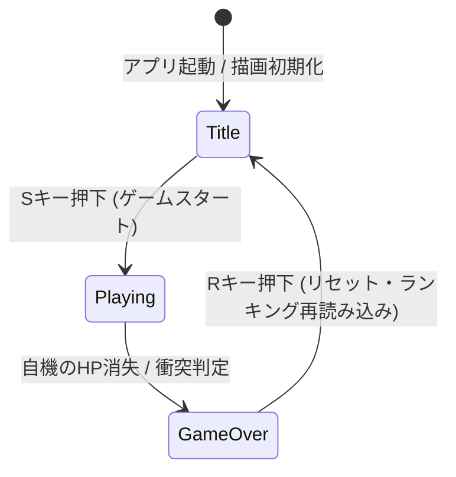

# 💥 シューティングゲーム (Canvas & Backend リアルタイム連携)

本プロジェクトは、HTML5の **Canvas機能** を用いた軽量なグラフィックス描画制御と、バックエンドに **Firebase Realtime Database** を組み合わせた、リアルタイム・スコアランキング機能付きのシューティングゲームです。

初学者向けの勉強会での教材（プロトタイプ）をベースに、実務に耐えうるインフラ層・データベース層の二重のセキュリティ設計を施した作品です。

---

## 🛡️ インフラ ＆ データベースの二重セキュリティ設計

フロントエンド（JavaScript）にAPIキーを記載せざるを得ない静的配信の特性を踏まえ、悪意のある第三者によるデータの改ざんやデータベースの不正利用を遮断する設計を行っています。

### 1. Google Cloud コンソールによる「HTTPリファラー制限」
APIキーの利用制限をかけ、ローカル環境（`localhost`）および**自身のGitHub Pagesドメイン（`https://github.io*`）以外からのリクエストをインフラ層で完全に遮断**しています。検証により、許可されたドメイン以外（訓練校環境など）からの直接アクセスが拒否されることを実証済です。

### 2. データベース層での「カスケード防止セキュリティルール」
Firebaseのルート直下に `".write": false` を厳格に適用し、データベース全体の丸ごと消去や不正上書きを防止しています。
ゲーム側から `push()` される個別スコア（`$push_id` 階層）のみに書き込み権限を下げる（カスケードを制限する）ことで、最小権限の原則に則った堅牢なデータ保護を成立させています。

---

## 📊 システム構造（有限ステートマシン）

勉強会において、AIが生成した初期コードにありがちな「複数の状態識別フラグ（title, playing, gameOver）の乱立によるスパゲティ化（論理不整合）」の危険性を指摘し、一元管理された「有限ステートマシン」へリファクタリングした画面遷移の論理構造です（Mermaidによる可視化）。

---

## 🛠️ 技術スタック
* **フロントエンド**: HTML5 Canvas, JavaScript (Vanilla JS), CSS3
* **バックエンド / インフラ**: Firebase Realtime Database, Google Cloud Platform (APIセキュリティ管理)

---

## 🚀 動作デモ (GitHub Pages)

本アプリはGitHub Pages機能を利用して、ブラウザ上で実際にプレイしてランキングへスコアを登録することが可能です。
* **[👉 シューティングゲームをプレイする](https://yabusan2-dot.github.io/shooting-game-firebase/)**

## 📥 補足データ・検証用Excelシート
* [シューティングゲームを題材にしたコード分析方法の解説シート (.xlsx)](./supplementary-materials/shooting_game.xlsx)
